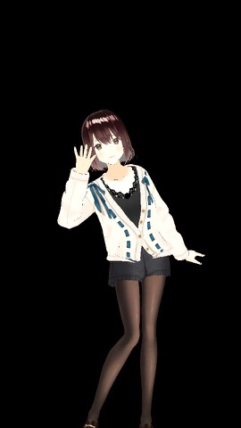

# 小智 · 全息陪伴机器人

一个放在桌上的 3D 全息陪伴角色。你对它说话，它一边回答，一边做表情、对口型；你让它帮忙做点小事，它会在后台把事情做完，再主动告诉你。



## 能做什么
- **语音陪伴**：可以用小智硬件设备说话，也可以在网页上直接打字聊天。回复用甜美的流式语音播放，第一个字通常不到 3 秒就能听到。
- **3D 形象**：VRM 角色会根据回复内容做表情、对口型、做待机动作，放进反射式全息仓里就是立体效果。网页面板手动换角色的功能正在开发。
- **帮你做小网页**:比如"帮我给小美做个表白网页"。网页在隔离的容器里生成,做好后小智会主动播报,全息仓上显示二维码,手机扫一下就能打开。目前支持表白页、心情日记、生日祝福、纪念日倒计时。
- **随时切换**:对话模型和做网页的模型可以在网页面板里选;语音引擎和音色的切换正在开发。

## 怎么搭起来的
```
小智设备 / 网页 ──语音/文字──▶ 小智服务端(语音识别、语音合成)
                                   │
                                   ▼
                             大脑(人设、记忆、工具调用) ──▶ 3D 角色页面(表情、口型、二维码)
                                   │
                                   ▼ MCP 工具
                             任务服务 ──▶ 隔离容器里的 Agent(按技能写网页)
                                   │
                                   └──▶ 网页发布 + 小智主动播报
```

## 用到的开源项目
- [xiaozhi-esp32-server](https://github.com/xinnan-tech/xiaozhi-esp32-server)：设备接入、语音识别和语音合成
- [Super Agent Party](https://github.com/heshengtao/super-agent-party)：大脑和 VRM 角色
- [Hermes Agent](https://github.com/NousResearch/hermes-agent)：在容器里完成网页任务
- [three-vrm](https://github.com/pixiv/three-vrm)：网页里渲染 VRM 角色
- 角色模型：[VRoid 官方样例](https://github.com/madjin/vrm-samples)（CC0 或 VRoid 样例授权）

这个仓库只做展示，代码不公开。
